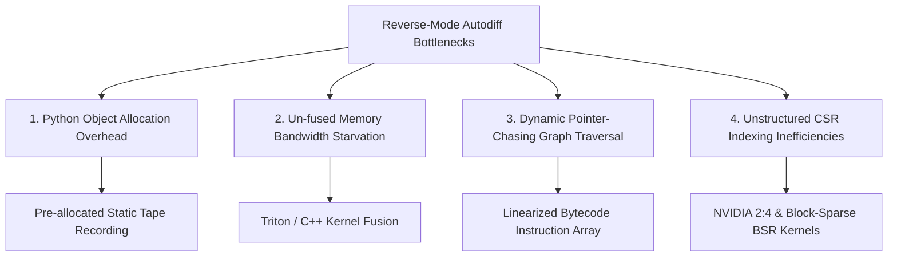
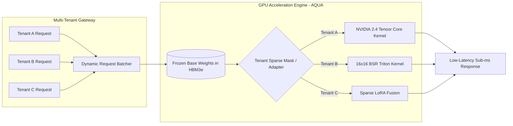

# Dynamic Sparse Neural Network Architecture & Systems Design

**Author:** Staff Machine Learning Systems Engineer  
**Repository:** First-Principles Autodiff & Dynamic Sparse Training Library (`dynamic-sparse-training`)  
**Core Technologies:** Python 3.10+, Pure NumPy, Matplotlib, Pytest  

---

## 1. Mathematical Foundations of Pruning Criteria

### 1.1 Taylor Series Expansion of the Loss Function
Consider a neural network parameterized by weight vector $W \in \mathbb{R}^P$ trained under loss function $\mathcal{L}(W)$. When pruning an individual connection $i$ by setting its weight to zero ($\Delta W = -w_i e_i$), the exact difference in empirical risk is:

$$\Delta \mathcal{L}_i = \mathcal{L}(W - w_i e_i) - \mathcal{L}(W)$$

Expanding $\mathcal{L}(W - w_i e_i)$ via a multivariable Taylor series around the current weight configuration $W$:

$$\mathcal{L}(W - w_i e_i) = \mathcal{L}(W) - w_i \frac{\partial \mathcal{L}}{\partial W_i} + \frac{1}{2} w_i^2 \frac{\partial^2 \mathcal{L}}{\partial W_i^2} + \mathcal{O}(|w_i|^3)$$

Rearranging gives the exact Taylor expansion for the loss perturbation:

$$\Delta \mathcal{L}_i \approx -w_i g_i + \frac{1}{2} w_i^2 H_{ii}$$

where $g_i = \nabla_{W_i} \mathcal{L}$ is the first-order gradient, and $H_{ii} = \nabla^2_{W_i W_i} \mathcal{L}$ is the diagonal element of the Hessian matrix.

Taking the absolute perturbation in loss yields the first-order Taylor importance criterion:

$$\mathcal{S}_{\text{Taylor}, i} = |w_i \cdot g_i|$$

---

### 1.2 Comparison: First-Order Taylor Saliency vs. Pure Magnitude Pruning
Traditional magnitude-based pruning uses the heuristic criterion:

$$\mathcal{S}_{\text{Magnitude}, i} = |w_i|$$

This assumes that smaller weights inherently contribute less to the model's loss landscape. While this heuristic holds approximately in fully converged networks with small learning rates, **it fails catastrophically during active dynamic training**:

| Scenario | Weight State | Magnitude Pruning ($|w_i|$) | First-Order Taylor ($|w_i \cdot g_i|$) | Systems/Optimization Reality |
| :--- | :--- | :--- | :--- | :--- |
| **Emergent Feature** | Small magnitude ($w_i \approx 0$), Large gradient ($g_i \gg 1$) | **Prunes prematurely** | **Preserves connection** | Weight is traversing an active gradient path; pruning severs an emergent feature representation. |
| **Stagnant / Dead Weight** | Large magnitude ($w_i \gg 0$), Zero gradient ($g_i \approx 0$) | **Preserves connection** | **Prunes connection** | Weight has reached an uninformative plateau; removing it produces zero loss perturbation. |
| **Well-Conditioned Parameter** | Moderate magnitude, Moderate gradient | Moderate score | High sensitivity | Accurately identifies parameters on critical loss contours. |

Thus, $|w_i \cdot g_i|$ directly reflects the **true instantaneous loss sensitivity** rather than parameter magnitude alone.

---

### 1.3 Exponential Moving Average (EMA) and Stochastic Variance Reduction
In stochastic mini-batch training, the empirical gradient $\hat{g}_i^{(B)}$ computed over mini-batch $B$ is a noisy estimate of the true population gradient:

$$\hat{g}_i^{(B)} = g_i + \epsilon_B, \quad \mathbb{E}[\epsilon_B] = 0, \quad \text{Var}(\epsilon_B) = \frac{\sigma^2}{|B|}$$

If pruning decisions rely on a single mini-batch's instantaneous $|w_i \hat{g}_i^{(B)}|$, random stochastic variance $\epsilon_B$ causes critical connections to be pruned simply because their mini-batch gradient momentarily crossed zero.

To eliminate mini-batch stochasticity without computing an expensive full-dataset pass, we maintain an Exponential Moving Average (EMA) across iterations $t$:

$$\bar{\mathcal{S}}_i^{(t)} = \beta \bar{\mathcal{S}}_i^{(t-1)} + (1 - \beta) |w_i \cdot g_i^{(t)}|, \quad \beta = 0.9$$

The effective sample window of this smoothing filter is $\frac{1}{1 - \beta} = 10$ mini-batches. Furthermore, to prevent score deadlock near initialization or at saddle points where $g_i \approx 0$, we introduce a small magnitude floor $\lambda_{\text{floor}} = 10^{-4}$:

$$\mathcal{S}_i = \bar{\mathcal{S}}_i^{(t)} + \lambda_{\text{floor}} |w_i|$$

---

## 2. Masked-Weight Autodiff Semantics & Optimizer State Isolation

### 2.1 Mathematical Formulation of Masked Layers
Let $W \in \mathbb{R}^{D_{\text{in}} \times D_{\text{out}}}$ denote the latent parameter tensor and $M \in \{0, 1\}^{D_{\text{in}} \times D_{\text{out}}}$ denote the binary sparsity mask.

The effective forward weight tensor $\tilde{W}$ is:

$$\tilde{W} = W \odot M$$

The forward layer operation computes:

$$y = x \tilde{W} + b = x (W \odot M) + b$$

Applying the chain rule for reverse-mode automatic differentiation:

$$\frac{\partial \mathcal{L}}{\partial W_{ij}} = \sum_{k, l} \frac{\partial \mathcal{L}}{\partial \tilde{W}_{kl}} \frac{\partial \tilde{W}_{kl}}{\partial W_{ij}} = \frac{\partial \mathcal{L}}{\partial \tilde{W}_{ij}} \cdot M_{ij}$$

Consequently:

$$\nabla_W \mathcal{L} = \nabla_{\tilde{W}} \mathcal{L} \odot M$$

where $\nabla_{\tilde{W}} \mathcal{L} = x^T \frac{\partial \mathcal{L}}{\partial y}$ represents the **raw unmasked gradient**.

---

### 2.2 Enabling RigL-Style Regrowth via `unmasked_grad`
In dynamic sparse training (such as RigL: *Rigged Lottery*), we do not merely prune weights; we dynamically regrow pruned connections that exhibit high gradient sensitivity:

$$\text{Regrowth Score}_{ij} = \left|\frac{\partial \mathcal{L}}{\partial \tilde{W}_{ij}}\right| = \left| \left(x^T \frac{\partial \mathcal{L}}{\partial y}\right)_{ij} \right|$$

Our reverse-mode autodiff engine isolates these two signals directly in `engine/tensor.py`:
1. `param.grad` is strictly masked: $\nabla_W \mathcal{L} = \nabla_{\tilde{W}} \mathcal{L} \odot M$. Any pruned weight ($M_{ij} = 0$) has `param.grad[i, j] == 0.0`.
2. `param.unmasked_grad` stores the full raw gradient $\nabla_{\tilde{W}} \mathcal{L}$.
3. Active connections are pruned based on lowest Taylor saliency; pruned connections are awakened based on largest `|unmasked_grad|`.

---

### 2.3 The Adam Momentum Corruption Problem & Formal Proof
Standard Adam maintains first and second moment estimators:

$$m_t = \beta_1 m_{t-1} + (1 - \beta_1) g_t$$
$$v_t = \beta_2 v_{t-1} + (1 - \beta_2) g_t^2$$

#### The Failure Mode:
Suppose weight $(i, j)$ is pruned at step $T$, so $M_{ij} = 0$ and $g_t = 0$ for $t > T$.
In unmasked Adam, the moment updates are:

$$m_t = \beta_1 m_{t-1} + 0 = \beta_1^{t - T} m_T \neq 0$$
$$v_t = \beta_2 v_{t-1} + 0 = \beta_2^{t - T} v_T \neq 0$$

Computing the bias-corrected update:

$$\hat{m}_t = \frac{m_t}{1 - \beta_1^t}, \quad \hat{v}_t = \frac{v_t}{1 - \beta_2^t}$$
$$\Delta W_{ij}^{(t)} = -\frac{\eta \hat{m}_t}{\sqrt{\hat{v}_t} + \epsilon} \neq 0$$

$$W_{ij}^{(t)} = W_{ij}^{(t-1)} - \Delta W_{ij}^{(t)} \neq 0$$

**Result:** Even though the gradient was zeroed, non-zero decaying momentum continuously updates the pruned weight, turning true zeros into drifting non-zero floating-point numbers! Furthermore, if connection $(i, j)$ is later regrown, the stale moments $m_t, v_t$ trigger an uncontrolled momentum jump.

#### The Mask-Aware Adam Fix:
In `nn/optim.py`, our Adam implementation enforces four invariants:
1. **Gradient Isolation:** $g_t \leftarrow g_t \odot M$.
2. **Decoupled Weight Decay Isolation:** $W \leftarrow W - \eta \lambda (W \odot M)$.
3. **State Isolation:** $m_t \leftarrow m_t \odot M$, $v_t \leftarrow v_t \odot M$.
4. **Hardware Zero Enforcement:** $W \leftarrow (W - \Delta W) \odot M$.
5. **Regrowth Zero-Reset:** When connection $(i, j)$ transitions from $0 \to 1$, `optim.reset_state_for_mask` explicitly resets $m_{ij} = 0.0, v_{ij} = 0.0$.

---

## 3. Autodiff Engine Systems Bottlenecks & Concrete Optimizations

While our pure Python/NumPy engine achieves high numerical precision and trains the 50,826-parameter network in under 2 seconds, scaling pure Python engines to larger foundation models exposes four fundamental systems bottlenecks:

### 3.1 Python Object Allocation & Interpreter Overhead
- **Bottleneck:** Every tensor operation (`__add__`, `__matmul__`) allocates a new Python `Tensor` object, builds closures (`_backward`), and mutates sets (`_prev`). Dynamic allocations dominate CPU execution cycles over actual floating-point computation.
- **Optimization Strategy:** Static Graph Compilation. During iteration 1, trace the computational graph into a contiguous static tape. Pre-allocate all activation and gradient buffers into a single flat NumPy memory pool, executing subsequent iterations with zero dynamic Python allocations.

### 3.2 Un-fused Memory Bandwidth Starvation
- **Bottleneck:** Compound operations like GELU:
  $$0.5 \cdot x \cdot (1 + \tanh(\sqrt{2/\pi}(x + 0.044715 x^3)))$$
  generate 7 intermediate NumPy array allocations. These intermediate arrays spill from L1/L2 CPU cache into main RAM, bound by DDR bus bandwidth.
- **Optimization Strategy:** Operator Fusion. Implement custom fused kernels (via Cython, C++, or OpenAI Triton) executing the entire polynomial and activation in a single cache-resident pass over registers.

### 3.3 Dynamic Topological Traversal Overhead
- **Bottleneck:** Iterative DFS traversal traversing Python sets (`visited`, `_prev`) incurs high branch mispredictions and pointer-chasing latency.
- **Optimization Strategy:** DAG Linearization. Linearize the reverse execution order once at compile time into a flat C-array of opcode function pointers and memory offsets.

### 3.4 NumPy CSR Loop Overhead vs. SIMD Vectorization
- **Bottleneck:** While `CSRLinear` skips zeros, iterating row pointers in Python incurs interpreter overhead per active row.
- **Optimization Strategy:** Block-Sparse Row (BSR) 16x16 / 32x32 layout. Packing non-zero weights into dense 16x16 blocks enables SIMD AVX-512 / ARM NEON vector instructions and GPU Tensor Cores to operate without index scattering.

---

## 4. Production Architecture: Multi-Tenant Inference Service on AQUA

To serve self-pruned sparse neural networks on the AQUA platform at scale (thousands of requests/sec with sub-millisecond SLA):

### 4.1 Hardware-Aware Sparsity: Unstructured vs. NVIDIA 2:4 Structured Sparsity
- **The Unstructured Trap:** Unstructured CSR sparsity requires high sparsity thresholds (>90-95%) on modern GPUs before overcoming non-coalesced memory access penalties relative to dense cuBLAS GEMM.
- **Hardware Solution:** 
  - **NVIDIA Ampere/Hopper/Blackwell 2:4 Structured Sparsity:** In every group of 4 contiguous weights, exactly 2 must be zero. Sparse Tensor Cores natively double math throughput (2x FLOPs) with zero index storage overhead.
  - **16x16 Block-Sparse Row (BSR):** Pruning entire 16x16 blocks preserves Tensor Core matrix multiplication efficiency while reducing memory bandwidth requirements proportionally to sparsity.

### 4.2 Multi-Tenant Memory Architecture
In an enterprise multi-tenant environment serving diverse clients:
1. **Shared Base Weight Backbone:** Base dense/sparse weights ($W_{\text{base}}$) are loaded once into high-bandwidth GPU memory (HBM3e).
2. **Tenant-Specific Dynamic Masks & Sparse LoRA Adapters:** Individual tenants maintain personalized sparse binary masks and low-rank adapters stored in high-speed SRAM / L2 cache.
3. **Continuous Dynamic Batching:** Incoming requests are grouped into dynamic ragged batches. A specialized Triton kernel evaluates:
   $$Y_b = X_b \cdot (W_{\text{base}} \odot M_{\text{tenant}(b)}) + X_b A_{\text{tenant}(b)} B_{\text{tenant}(b)}$$
   executing multi-tenant inference concurrently without duplicating base model weights in GPU VRAM.
